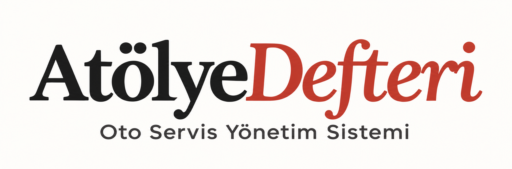
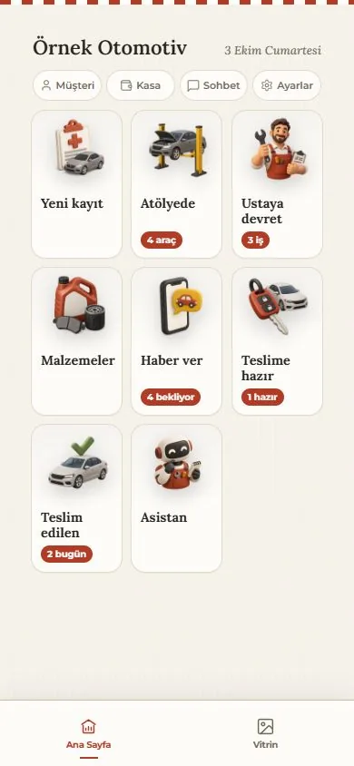
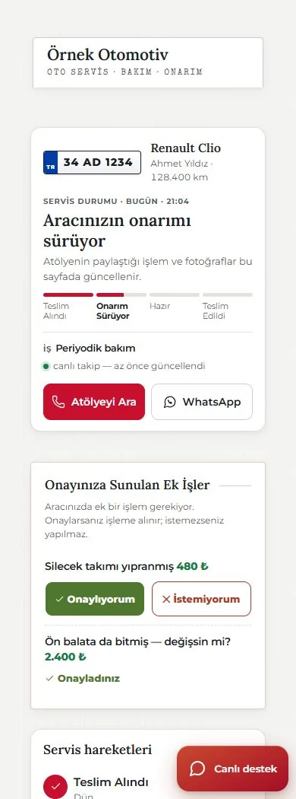
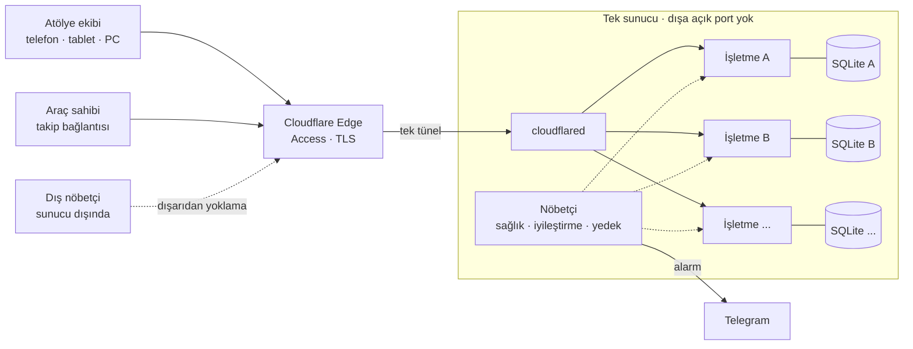

  

  <b>Oto servisler için müşteri, araç, iş emri ve tahsilat platformu</b> 
  <a href="https://atolyedefteri.com">atolyedefteri.com</a> · <a href="https://demo.atolyedefteri.com">Canlı demo</a>

  
  
  
  
  

> **Bu repo bir mühendislik vaka çalışmasıdır.** Ürünün kaynak kodu özeldir ve burada yer almaz. Burada ürünün ne yaptığını, nasıl tasarlandığını ve canlıda nasıl ayakta tutulduğu anlatılıyor.

*English: Atölye Defteri is a workshop-management SaaS for auto repair shops in Türkiye, used by 8 businesses and ~45 people daily. It includes a 17-tool LLM agent with permission checks and human approval, and it runs multi-tenant on a single VPS with zero open ports, self-healing watchdogs, verified backups and canary releases. Source code is private; this repo documents the engineering.*

---

## Problem

Bir oto sanayi atölyesinin günü şu sorularla geçer: Hangi araç tamirde? Parça geldi mi? Müşteriye haber verildi mi? Kim ne kadar borçlu? Cevaplar genellikle bir deftere, bir WhatsApp grubuna ve ustanın hafızasına dağılmış durumdadır. Müşteri de "Usta, araç ne oldu?" diye günde birkaç kez arar.

## Çözüm

Atölye Defteri bütün bu akışı tek bir deftere toplar: **kabul → atölye → ustaya devir → teslime hazır → kasa**. Müşteri ise kendisine gönderilen bağlantıdan aracının durumunu, işlem fotoğraflarını ve ek iş tekliflerini görür; uygulama indirmesi ya da hesap açması gerekmez.

  
  

Gerçek uygulama ekranları · kurgusal örnek kayıtlar

| Atölyede | Müşteride |
|---|---|
| Ruhsat fotoğrafından otomatik kayıt (tarayıcıda OCR) | Canlı servis aşaması |
| Hasar şeması ve ekspertiz, dijital imza | Öncesi/sonrası işlem fotoğrafları |
| Usta bazlı iş atama, "İşlerim" ekranı | Ek işe telefondan onay veya ret |
| Kasa, tahsilat, alacak; yetkisize para gösterilmez | Servis raporu (PDF) |
| Bakım hatırlatma, kayıp müşteri takibi | Takip ekranından atölyeye yazma |
| İşletmeye özel web sitesi | — |

---

## Mimari

**Temel kararlar**

- **Tek kod, ayrı veri.** Bütün işletmeler aynı kod ağacından çalışır; her birinin süreci, veritabanı ve dosyaları ayrıdır. Kod dizini canlıda salt okunurdur.
- **Bağımlılık neredeyse sıfır.** Backend saf Python standart kütüphanesiyle yazıldı. Docker, nginx, Redis ve kuyruk sistemi yok; sahada bozulabilecek parça sayısı az.
- **İnternet bir varsayım değil.** OCR, barkod ve QR motorları yerelde çalışır. Atölyede internet kesildiğinde de ekran açılır.
- **Sıfır açık port.** Dünyaya açık tek kapı Cloudflare tünelidir; yönetim yalnız SSH anahtarıyla yapılır. Yönetim paneli ayrıca Cloudflare Access, TOTP ve PIN ile korunur ve yapılandırılmamışsa kapalı başlar.

Ayrıntılar: [docs/mimari.md](docs/mimari.md)

---

## Defterci: kasaya dokunan bir yapay zekâ asistanını güvenli yapmak

Defterci, atölye kayıtlarıyla çalışan bir LLM ajanıdır. Kullanıcı "Bugün ne var?" diye sorar; Defterci günün işlerini özetler, eksik bilgileri gösterir ve müşteriye gidecek mesajı hazırlar.

| | |
|---|---|
| Araç kataloğu | **17 araç:** 7 okuma (iş arama, günlük özet, kasa özeti, açıkta kalanlar…), 10 öneri (tahsilat, aşama değiştirme, randevu, mesaj taslağı…) |
| Yazma kuralı | Kayıt değiştiren hiçbir işlem doğrudan yapılmaz. Öneri kullanıcıya gösterilir; onay gelirse uygulamanın kendi işlem uçları çalışır. |
| Yetki | Modele sunulan araçlar kullanıcının yetkisinden türetilir; araç çalıştırılırken yetki yeniden kontrol edilir. |
| Gizlilik | Telefon, adres ve şase numarası modele hiç gönderilmez. Plaka ve serbest metin maskelenir. Para alanları yalnız yetkili kullanıcının bağlamında yer alır. |
| Dayanıklılık | Araç döngüsünde çağrı sınırı ve bozuk yanıt kontrolü var. Kötü niyetli kullanım senaryoları için ayrı test dosyaları var. |
| İlke | **Defterde olmayan söylenmez.** Bilinmeyen bilgi "bilinmiyor" diye görünür. |

Ayrıntılar: [docs/defterci.md](docs/defterci.md)

---

## Canlıda ayakta tutmak

| Katman | Ne yapıyor |
|---|---|
| **İç nöbetçi** | 2 dakikada bir sırayla tüneli, süreçleri, dışarıdan erişimi, veritabanı bütünlüğünü ve yedek yaşını kontrol eder. Düşen kurulumu kendisi kaldırır. Yalnız durum değiştiğinde haber verir ve bildirimin gerçekten iletildiğini doğrular. |
| **Dış nöbetçi** | Sunucunun dışında çalışır. Makine tümden çökerse iç nöbetçi de susar; dış nöbetçi bunu yakalayıp doğrudan haber verir. Arıza senaryosu gerçekten denenmiştir. |
| **Yedek** | 60 saniyelik tutarlı ayna, 6 saatlik arşiv ve sunucu dışı kopya. Her arşiv kendini doğrular. Geri yükleme tatbikatı yapıldı: bir kurulum yedekten ~2 saniyede ayağa kalktı. |
| **Yayın** | Yeni sürüm önce kanarya halkasına çıkar; testler yeşilse kararlı halkaya geçer. Her halkanın geri dönüş noktası vardır. Yayından önce ve sonra **para sayımı** yapılır; iki sayı birebir aynı olmalıdır. |
| **Test** | 4.000'i aşkın otomatik test: yetki, işletmeler arası yalıtım, eşzamanlı tahsilat, yapay zekâ kötüye kullanımı. |

Canlıda yaşanan olaylardan çıkan dersler: [docs/canlidan-dersler.md](docs/canlidan-dersler.md)

---

## Ürün ilkeleri

1. **Para dokunulmazdır.** Silinmez, yetkisize gösterilmez.
2. **İnternet bir varsayım değildir.**
3. **Önce patronun bakışı;** aynı ekran çalışanda yetkisine göre sadeleşir.
4. **Defterde olmayan söylenmez.**
5. **Veri atölyenindir.** Abonelik bitse de silinmez, tam kopyası teslim edilir.

---

## Teknoloji

`Python (stdlib)` · `SQLite (WAL)` · `JavaScript (modüler arayüz)` · `Tesseract.js (WASM)` · `Anthropic Claude API` · `Cloudflare Tunnel & Access` · `systemd` · `Ubuntu` · `Electron` · `Capacitor`

## Geliştiren

**Muhammed Said Tunç**: Kurucu & Full Stack Geliştirici · [LinkedIn](https://www.linkedin.com/in/saidtunc/) · [atolyedefteri.com](https://atolyedefteri.com)

---

© 2026 Atölye Defteri A.Ş. Tüm hakları saklıdır. Bu repodaki metin ve görseller yalnız tanıtım amaçlıdır; herhangi bir açık kaynak lisansıyla sunulmaz.
