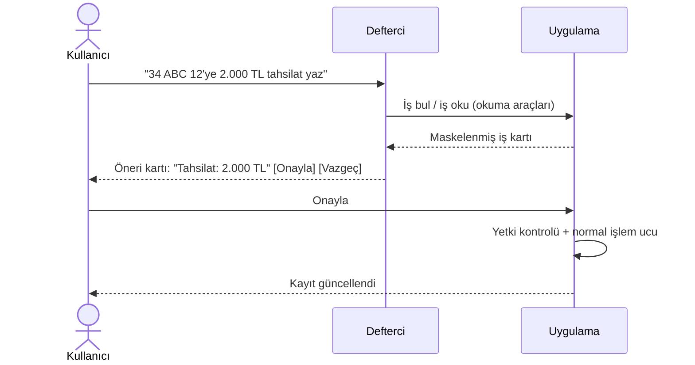

# Defterci

[← Ana sayfa](../README.md)

Defterci, Atölye Defteri'nin içindeki yapay zekâ asistanıdır. Atölyenin kayıtlarıyla çalışır: "Bugün ne var?" sorusuna günün özetini verir, eksik bilgileri gösterir, müşteriye gidecek mesajı hazırlar.

Zor olan kısım asistanın konuşması değildi. Zor olan, **müşteri verisine ve kasaya erişen** bir dil modelinin yanlış bir şey yapamayacağından emin olmaktı. Bu sayfa o tasarımı anlatır. Sistem promptları ve kaynak kod paylaşılmaz.

---

## Araç kataloğu

Model, uygulamayla yalnız tanımlı araçlar üzerinden konuşur. Toplam 17 araç var ve iki gruba ayrılıyor:

| Okuma (7) | Ne yapar |
|---|---|
| Defter özeti | Atölyedeki açık işler, aşamaları, kaç gündür içeride oldukları |
| İş bulma | Plaka, müşteri ya da araçla açık iş arama |
| İş okuma | Bir işin kartı: aşama, yapılacaklar, eksikler |
| Görevler | Bakımı gelen, memnuniyeti sorulacak, uzun süredir uğramayan müşteriler |
| Açıkta kalanlar | Bütün açık işleri eksik gözüyle tarama |
| Ekip özeti | Kimde kaç iş var, kim kaç iş teslim etti |
| Kasa özeti | Ayın cirosu, tahsilat ve kalan alacak (yalnız yetkiliye) |

| Öneri (10) | Ne önerir |
|---|---|
| İşlem ekleme · not yazma · eksik bilgi tamamlama | İş kaydına ekleme |
| Aşama değiştirme | Kabul → Tamirde → Hazır → Teslim |
| Tahsilat yazma | Müşteriden alınan ödemeyi kaydetme |
| Fotoğraf ekleme | Sohbete eklenen kareyi işe iliştirme |
| Yeni kayıt | Tek cümleden müşteri + araç + iş emri |
| Randevu | Telefonla alınan randevuyu deftere yazma |
| Müşteri onayı isteme | Ek iş için onay ekranını hazırlama |
| Mesaj hazırlama | Müşteriye gidecek WhatsApp metni |

Araçların girdileri JSON Schema ile tanımlıdır. Model çok adımlı çalışır: bir işi bulur, kartını okur, ardından öneri hazırlar.

## Yazma kuralı: model hiçbir şeyi kendisi değiştirmez

- Öneri araçları kayda hiçbir şey yazmaz; yalnız bir **öneri kartı** üretir.
- Kullanıcı onay verdiğinde uygulamanın normal işlem uçları çalışır. Bu uçlar, insan aynı işlemi elle yaptığında da kullanılan, aynı yetki ve iş kurallarına tabi uçlardır.
- Konuşmada bir işlemin anlatılmış olması o işlemin yapıldığı anlamına gelmez. Ödeme ancak kullanıcı kaydettiğinde kayda geçer.

## Yetki

- Modele sunulan araç listesi kullanıcının yetkisinden türetilir. Kasa yetkisi olmayan bir çalışanın asistanı kasa aracını hiç görmez.
- Araç çalışırken yetki **yeniden** kontrol edilir. Model listede olmayan bir aracı çağırmaya kalkarsa çağrı reddedilir.
- Para alanları yalnız yetkili kullanıcının bağlamına girer.

## Gizlilik

- **Telefon, adres ve şase numarası modele hiç gönderilmez.**
- Plaka ve serbest metin alanları maskelenir.
- Modele giden bağlamın uzunluğu sınırlıdır. Yalnız soruyu cevaplamak için gereken kayıtlar gönderilir.

## Dayanıklılık

- Araç döngüsünde tur sınırı var; model kendini sonsuz döngüye sokamaz.
- Bozuk ya da beklenmeyen model yanıtları yakalanır ve kullanıcıya anlaşılır bir mesaj gösterilir.
- **Defterde olmayan söylenmez.** Kayıtta olmayan bir bilgi uydurulmaz; "bilinmiyor" olarak görünür.

## Test

Yetki dışı araç talepleri, hassas veri sızdırma girişimleri, işletmeler arası veri erişimi ve kötü niyetli kullanım senaryoları için ayrı test dosyaları var. Bu testler, uygulamanın 4.000'i aşkın otomatik testinin bir parçası olarak her yayından önce çalışır.
