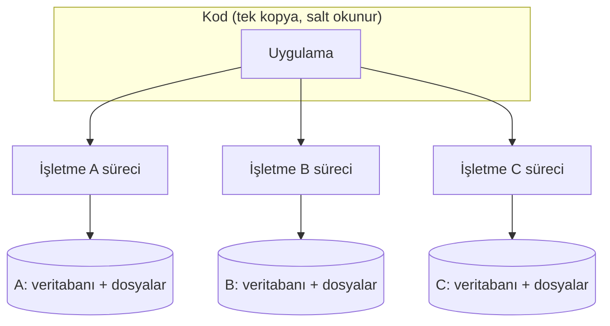
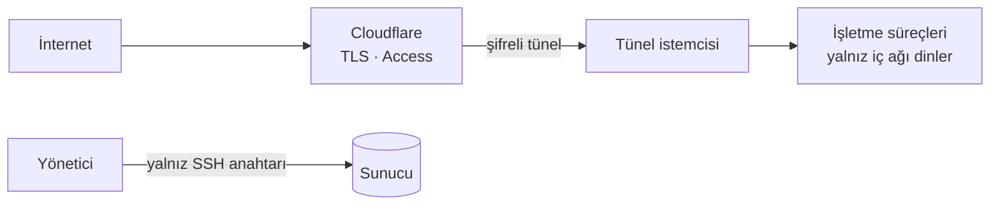
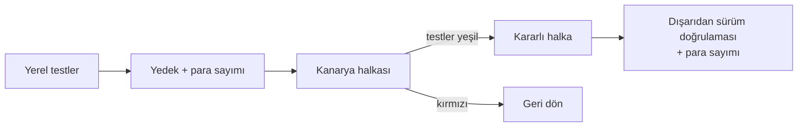

# Mimari

[← Ana sayfa](../README.md)

Atölye Defteri'nin birden çok işletmeyi tek sunucudan, kesintisiz ve birbirinden yalıtılmış şekilde nasıl çalıştırdığını anlatır. Uygulama kodu bu repoda yer almaz.

---

## 1. Tek kod, ayrı veri

- Bütün işletmeler aynı kod ağacından çalışır. Her işletmenin ayrı bir süreci, ayrı bir veritabanı ve ayrı bir dosya alanı vardır.
- Veri yolları koda gömülü değildir; süreç başlatılırken verilir. Bu sayede bir işletmenin dosyası başka bir işletmenin alanına yazılamaz.
- Kod dizini canlıda salt okunurdur. Her süreç yalnız kendi veri alanına yazabilir.
- Güncelleme tek yerden yapılır: kod değişir, süreçler yeniden başlar.

## 2. Az parça, az arıza

| Tercih | Gerekçe |
|---|---|
| Backend saf Python standart kütüphanesiyle | Sahada kurulacak, sürümü takip edilecek paket yok |
| Her işletmeye bir SQLite (WAL) | Veri tek dosyada durur; kopyalanabilir, taşınabilir, işletmeye teslim edilebilir |
| Docker, nginx, Redis ve kuyruk sistemi yok | Bu ölçekte kazandıracaklarından çok bozulabilecekleri şey var |
| OCR, barkod ve QR kütüphaneleri yerelde | Atölyede internet kesildiğinde de ekran açılır |

## 3. Dışarıya kapalı sunucu

- Sunucuda dışarıya açık uygulama portu yoktur. Dünyadan gelen trafik yalnız şifreli tünel üzerinden içeri girer.
- Uygulama süreçleri yalnız sunucunun kendi iç ağını dinler. Güvenlik duvarı bir gün yanlış ayarlansa bile bu ikinci bir kilit olarak devrede kalır.
- Yönetim paneli üç katmanla korunur: kimlik kapısı, telefondaki tek kullanımlık kod (TOTP) ve panel girişi. Panel yapılandırılmamışsa dışarıdan gelen her isteği reddeder.
- Yönetici erişimi yalnız SSH anahtarıyla yapılır; parola ile giriş kapalıdır.

## 4. Kendini izleyen sistem

**İç nöbetçi** birkaç dakikada bir, her seferinde aynı sırayla şunları kontrol eder:
1. Tünel ayakta mı? Tünel düşmüşse süreçler çalışsa bile kimse ulaşamaz.
2. İşletme süreçleri çalışıyor mu? Düşen süreci kendisi kaldırır; deneme sayısının bir üst sınırı vardır.
3. Müşterinin gördüğü adres dışarıdan gerçekten açılıyor mu?
4. Veritabanları sağlam mı?
5. Son yedek ne kadar eski?

Nöbetçi yalnız **durum değiştiğinde** haber verir; sürekli aynı uyarıyı gönderen bir sistem kısa sürede susturulur. Gönderdiği her bildirimin gerçekten iletilip iletilmediğini de kaydeder.

**Dış nöbetçi** sunucunun dışında çalışır. Makine tümden çökerse iç nöbetçi de onunla birlikte susar; dış nöbetçi bu durumu yakalar ve doğrudan haber verir. Bu senaryo sahte bir arızayla gerçekten denenmiştir.

## 5. Yedek

| Katman | Sıklık | Amaç |
|---|---|---|
| Ayna | ~1 dakika | En kötü durumda yaklaşık bir dakikalık veri kaybı |
| Arşiv | 6 saat | Veritabanları, fotoğraflar ve ayarlar tek pakette |
| Sunucu dışı kopya | Arşivle birlikte | Disk ya da makine giderse veri başka bir yerde durur |

- Çalışan veritabanının dosyası düz kopyalanmaz; SQLite'ın tutarlı yedek mekanizması kullanılır.
- Her arşiv alındıktan sonra açılıp doğrulanır. Bozuk arşiv alarm üretir.
- Yaklaşık iki haftalık arşiv saklanır. Bozulmalar her zaman hemen fark edilmez; geriye dönüp sağlam bir kopya bulabilmek gerekir.
- **Geri yükleme tatbikatı yapıldı:** Bir kurulum yedekten yaklaşık 2 saniyede ayağa kalktı. Geri yükleme aracının canlıya dokunmadan deneme yapan bir prova kipi de var.

## 6. Yayın

- İşletmeler halkalara ayrılır. Yeni sürüm önce **kanarya** halkasına çıkar; testler orada da yeşilse **kararlı** halkaya geçer. Bozuk bir sürüm en fazla kanaryadaki işletmeyi etkiler.
- Her halka güncellenmeden önce bir geri dönüş noktası arşivlenir.
- Yayından önce ve sonra bütün işletmelerin para toplamları sayılır. İki sayı birebir aynı değilse yayın tamamlanmış sayılmaz.
- "Yayın tamam" kararı dosyaya bakılarak değil, dışarıdan alınan sürüm bilgisine bakılarak verilir.

## 7. Bilinçli sınırlar

- Yatay ölçekleme yok. Bugünkü ölçekte tek sunucu fazlasıyla yeterli; işletme sayısı büyüdükçe yeniden değerlendirilecek.
- Konteyner yok. İşletmeler süreç ve dosya izinleri düzeyinde yalıtılıyor. Bu ürünün kiracıları müşteri, saldırgan değil.
- Merkezi log toplama yok. Olaylar dosyada tutuluyor ve belirli bir süre sonra budanıyor.
